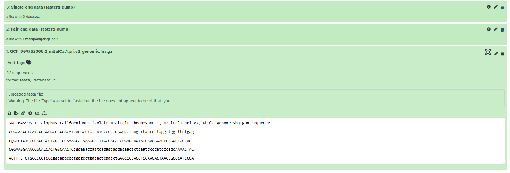
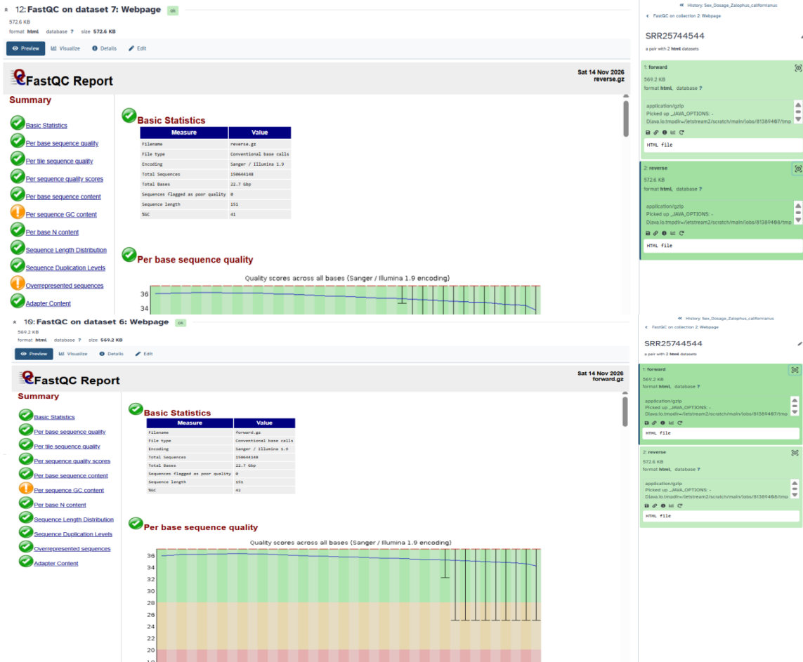
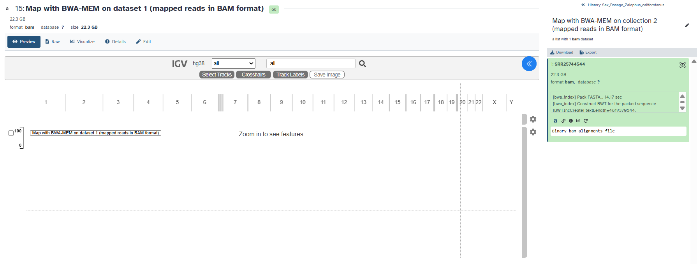
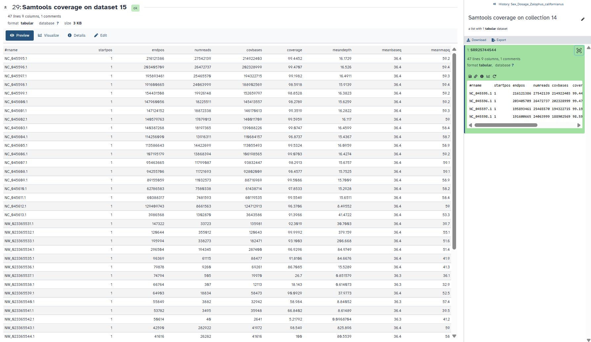
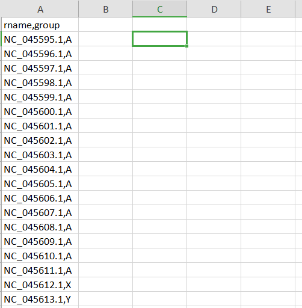
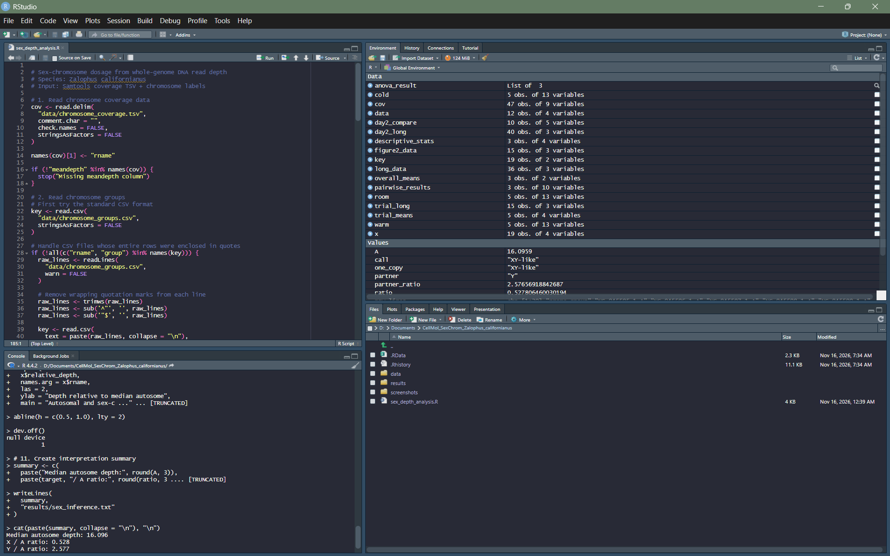

# Sex-Chromosome Dosage Analysis in the California Sea Lion (*Zalophus californianus*)

### Cell and Molecular Biology | Individual Practical Exercise

**Student Name:** Ijan, Shane Mae B.  
**Student ID:** 202400735  
**Section:** A  

---

## Project Overview

This project investigates sex-chromosome dosage in the California sea lion (*Zalophus californianus*) using whole-genome sequencing (WGS) data and a chromosome-level reference genome. The analysis was conducted using the Galaxy platform for sequence quality assessment, read alignment, and chromosome coverage estimation, followed by R for data processing, visualization, and sex-chromosome dosage interpretation.

The primary objective of this exercise is to calculate the X-to-autosome (X:A) sequencing-depth ratio and use it to infer the sex-chromosome complement of the WGS donor. The inferred result is then compared with the sex information recorded in the NCBI BioSample metadata.

## 1. Introduction

Sex determination in mammals generally follows an XX/XY chromosomal system, in which females typically possess two X chromosomes (XX), while males possess one X and one Y chromosome (XY). Because autosomes are ordinarily present in two copies in diploid individuals, differences in sequencing coverage between sex chromosomes and autosomes can provide evidence of sex-chromosome dosage.

In an XX individual, the expected X-to-autosome (X:A) sequencing-depth ratio is approximately 1.0, whereas an XY individual typically has a ratio near 0.5. These expected values provide a basis for interpreting whole-genome sequencing data, although technical and biological factors may influence the observed ratios.

This study focuses on the California sea lion (*Zalophus californianus*), a marine mammal belonging to the family Otariidae. As a placental mammal, it follows the XX/XY sex-determination system. Its chromosome-level reference genome contains annotated autosomes and X and Y chromosomes, making it suitable for chromosome dosage analysis.

By combining whole-genome sequencing data, chromosome coverage estimates, and computational analysis, this exercise demonstrates how sequencing depth can be used to investigate sex-chromosome complement while considering the limitations of reference-based analysis.

## 2. Reference Genome and Sequencing Data

| Information | Accession or Description |
|---|---|
| Species | *Zalophus californianus* |
| Common name | California sea lion |
| Reference assembly | GCF_009762305.2 |
| Assembly name | mZalCal1.pri.v2 |
| Assembly BioSample | SAMN12368149 |
| WGS run | SRR25744544 |
| WGS BioSample | SAMN12368149 |
| Sequencing platform | Illumina NovaSeq 6000 |
| Sequencing layout | Paired-end |

The reference genome assembly and WGS dataset are associated with the same BioSample accession (`SAMN12368149`), indicating that they originate from the same recorded biological donor. This allows the inferred sex-chromosome complement to be compared with the donor's reported sex in the NCBI metadata.

### Data Sources

- [NCBI Reference Genome Assembly](https://www.ncbi.nlm.nih.gov/assembly/GCF_009762305.2)
- [NCBI WGS Run](https://www.ncbi.nlm.nih.gov/sra/?term=SRR25744544)
- [NCBI BioSample](https://www.ncbi.nlm.nih.gov/biosample/SAMN12368149)
- [Galaxy Platform](https://usegalaxy.org/)

---

## 3. Materials and Methods

### 3.1. Reference Genome and WGS Data Acquisition

The chromosome-level reference genome of the California sea lion (*Zalophus californianus*) was obtained from NCBI using assembly accession `GCF_009762305.2` (`mZalCal1.pri.v2`). Whole-genome sequencing (WGS) reads were retrieved from NCBI SRA under accession `SRR25744544` (BioSample `SAMN12368149`), generated using an Illumina NovaSeq 6000 platform with paired-end 151-bp reads.

The reference FASTA and paired-end FASTQ datasets were imported into Galaxy (https://usegalaxy.org/) using the reference upload and `fastq-dump` tools, respectively. The datasets were organized in the Galaxy history `Sex_Dosage_Zalophus_californianus`.

*Figure 1. Reference genome and paired-end WGS datasets imported into Galaxy.*

### 3.2. Sequence Quality Assessment Using FastQC

Sequence quality was assessed using **FastQC** in Galaxy. The reports were examined for per-base sequence quality, GC content, sequence length distribution, and other quality indicators before proceeding to alignment.

*Figure 2. FastQC quality-control report for the paired-end sequencing reads.*

### 3.3. Read Alignment Using BWA-MEM

Paired-end WGS reads were aligned against the reference genome using **BWA-MEM** in Galaxy. The resulting BAM alignment dataset was used for chromosome-level coverage estimation.

*Figure 3. BWA-MEM alignment and resulting BAM dataset in Galaxy.*

### 3.4. Chromosome-Level Coverage Estimation Using Samtools

Chromosome-level sequencing depth was calculated from the BAM dataset using **Samtools coverage** in Galaxy. A minimum mapping quality (MAPQ) of **20** and minimum base quality of **20** were applied. Unmapped, duplicate, secondary, and quality-control-failed reads were excluded.

The output contained 47 reference-sequence entries, including mean sequencing depth and other coverage statistics, and was downloaded as `data/chromosome_coverage.tsv`.

*Figure 4. Samtools coverage settings used to estimate chromosome-level sequencing depth.*

### 3.5. Chromosome Identification and Classification

Chromosomes were identified using NCBI reference annotations and sequence accession names from the Samtools coverage output.

| Chromosome group | Reference accessions |
|---|---|
| 17 autosomes | `NC_045595.1` to `NC_045611.1` |
| X chromosome | `NC_045612.1` |
| Y chromosome | `NC_045613.1` |

Mitochondrial DNA (`NC_008416.1`) and unplaced scaffolds (`NW_` accessions) were excluded. Chromosome labels were recorded in `data/chromosome_groups.csv` using the groups `A`, `X`, and `Y`.

*Figure 5. Classification of autosomal and sex-chromosome reference sequences.*

### 3.6. Chromosome Dosage Analysis Using RStudio

Chromosome coverage was analyzed in **RStudio** using `sex_depth_analysis.R`. The script combined `chromosome_coverage.tsv` and `chromosome_groups.csv`, calculated the median mean depth across 17 autosomes, and normalized each chromosome's mean depth against this value.

**Relative depth = Chromosome mean depth / Median autosomal depth**

The script generated:

- `results/chromosome_relative_depth.csv` — normalized chromosome coverage
- `results/chromosome_depth.png` — relative-depth bar plot
- `results/sex_inference.txt` — calculated ratios and sex inference

*Figure 6. Chromosome dosage analysis performed in RStudio.*

### 3.7. Sex-Chromosome Complement Interpretation and Validation

The X-to-autosome (X:A) ratio was interpreted using the expected values for a diploid XX/XY system: approximately **1.0 for XX** and **0.5 for XY**. These values were treated as classroom guidelines rather than definitive diagnostic thresholds.

The inferred complement was compared with the recorded sex of NCBI BioSample `SAMN12368149`, shared by the reference assembly and WGS dataset. Potential effects of repetitive regions, mapping bias, pseudoautosomal sequences, and incomplete sex-chromosome assemblies were considered when interpreting the results.

The final inference was based on sequencing-depth evidence rather than chromosome lengths or the reference assembly alone.
